# Supply Chain Inventory Risk and Demand Analysis System

For the detailed architecture and data-flow explanation, see [the technical walkthrough](TECHNICAL_WALKTHROUGH.md).

## Project Summary

This system provides a live supply-chain dashboard backed by MySQL and an optional Neo4j graph. The Next.js frontend consumes an Express API. MySQL stores operational entities and analytics data; Neo4j models supplier-to-product and product-to-warehouse relationships.

## Architecture

- Frontend: Next.js 15, React 19, TypeScript, Recharts.
- API: Node.js and Express, JWT authentication, bcrypt password hashing.
- Relational database: MySQL, including operational tables, two reporting views, two stored procedures, and two triggers.
- Graph database: Neo4j, synchronized from MySQL using `MERGE` and uniqueness constraints.

## ER Diagram

The diagram reflects the foreign keys inspected in the live database on 2026-11-02. `APP_USERS` is a separate application-authentication table. `CATEGORY.parent_category_id` and `UOM.base_uom_id` are self-references and are omitted from the drawing for readability.

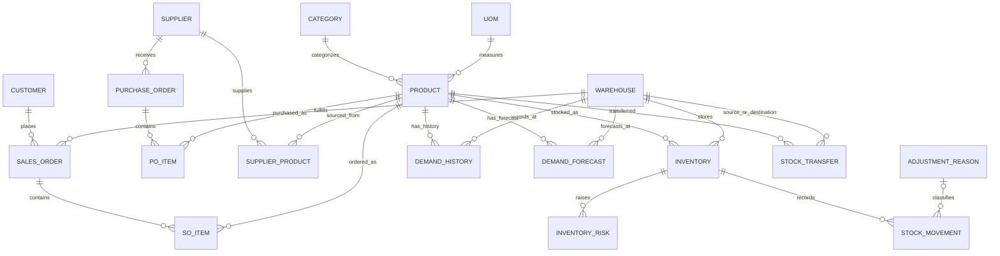

The database contains 18 project tables plus 3 application-owned tables (`app_users`, `app_managed_orders`, and `app_order_reservations`), 2 views (`vw_inventory_status`, `vw_sales_order_summary`), 2 procedures (`GetLowStock`, `GetSupplierProducts`), and 2 triggers (`auto_stockout_risk`, `check_stock_before_order`).

## Implemented Workflows

- Admin and staff authentication uses bcrypt-hashed passwords and signed JWTs.
- Products can be created and updated by admin/staff; deletion is admin-only.
- Inventory quantity adjustments are transactional and invoke the stock-risk trigger.
- Demand analytics return history, forecasts, and a per-product summary.
- Risk analytics return totals and inventory-linked risk records.
- Neo4j synchronization is admin-only and materializes `SUPPLIES` and `STORED_AT` relationships.
- Admin/staff can create pending orders with stock reservations and cancel pending orders with stock release. Only admins can delete cancelled orders; confirmed, shipped, and delivered orders remain protected from edits/deletion.
- The order form displays availability for the selected warehouse and constrains each quantity to the lookup stock; the API still rechecks availability inside the reservation transaction.
- The order reservation ledger marks only orders created through this app; legacy seeded orders remain read-only in the order controls.
- Past or malformed required dates are rejected by the API before they hit the database check constraint; the UI also prevents selecting past dates.
- Add Inventory hides already-used product/warehouse pairs, and the API responds with a conflict if a duplicate is submitted.

## Verification Record

Verified locally on 2026-11-02:

- `GET /api/health`: MySQL connected.
- Dashboard: 25 products, 5 warehouses, 12 suppliers, 25 customers, 33 inventory rows, and 26 sales orders.
- Product, inventory, and order list endpoints responded successfully.
- Demand endpoint: 30 history rows, 25 forecast rows, and 15 summary rows.
- Risk endpoint: 19 risk records.
- Neo4j health, summary, and supplier-network endpoints responded successfully; 12 suppliers, 5 warehouses, 25 products, and 96 relationships were reported.
- `npm run test:all` passed: 3 auth/role unit tests plus 15 MySQL read routes, analytics, stored procedures, product/inventory/order CRUD paths, validation failures, stock triggers, role restrictions, reservation-ledger checks, and optional Neo4j endpoints.
- The Add Inventory form was manually exercised using a temporary admin and an unused product/warehouse pair; the created inventory row and admin account were removed afterward.
- The order form was manually exercised using the same disposable stock: create, reserve, cancel, release, and delete all succeeded; temporary order and inventory data were removed.
- Browser check confirmed selecting HSR + Milk displayed `70` available and set the quantity input maximum to `70`.
- `GetLowStock` and `GetSupplierProducts` both executed successfully against the live database.
- `check_stock_before_order` rejected an order line that exceeded available stock; the enclosing order transaction was rolled back.
- Backend JavaScript syntax check passed.
- `npm test`: 3 auth/role middleware tests passed.
- Frontend `npm run lint` passed with no warnings.
- Frontend `npm run build` passed.

## Screenshots

Captured from the running local application:

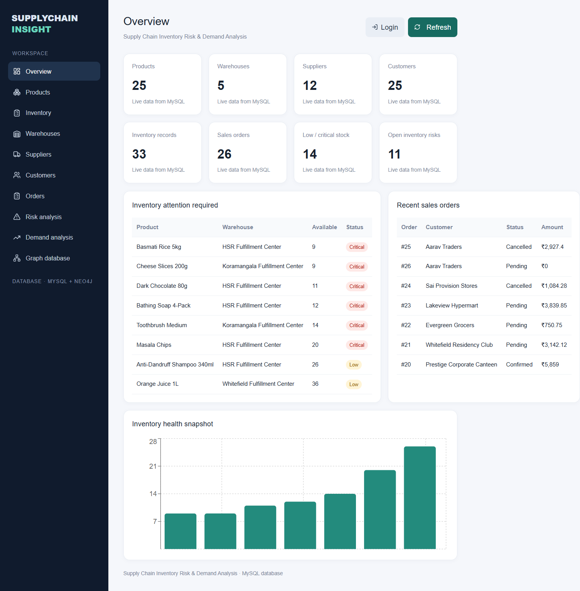

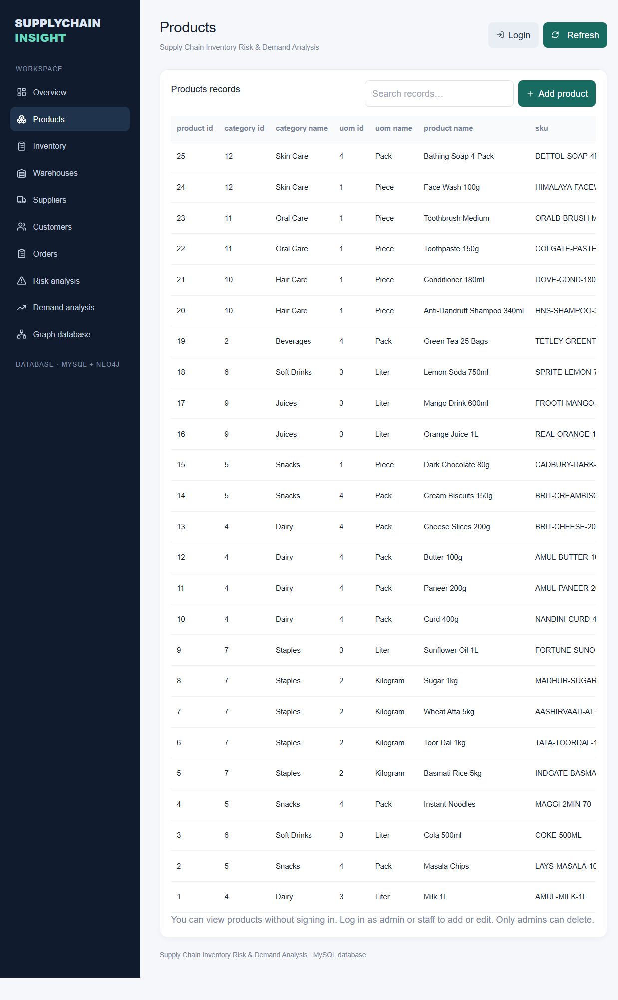

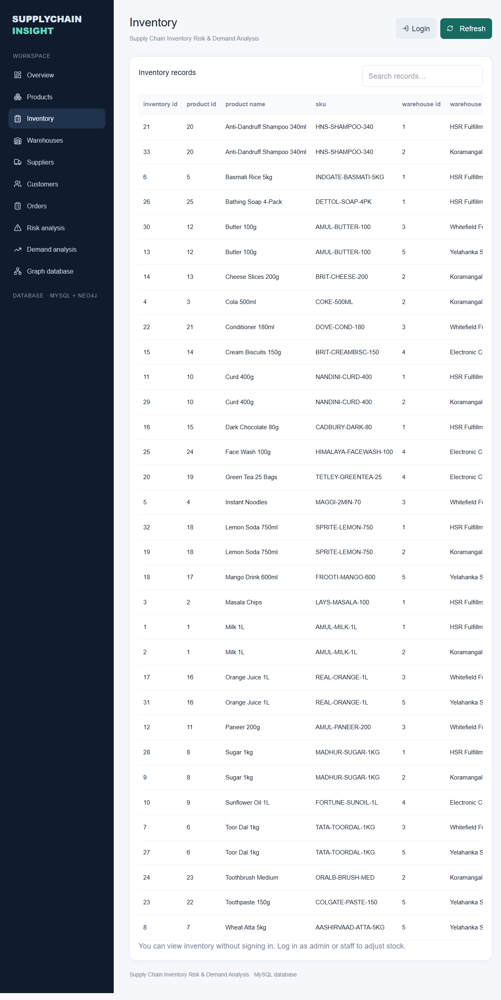

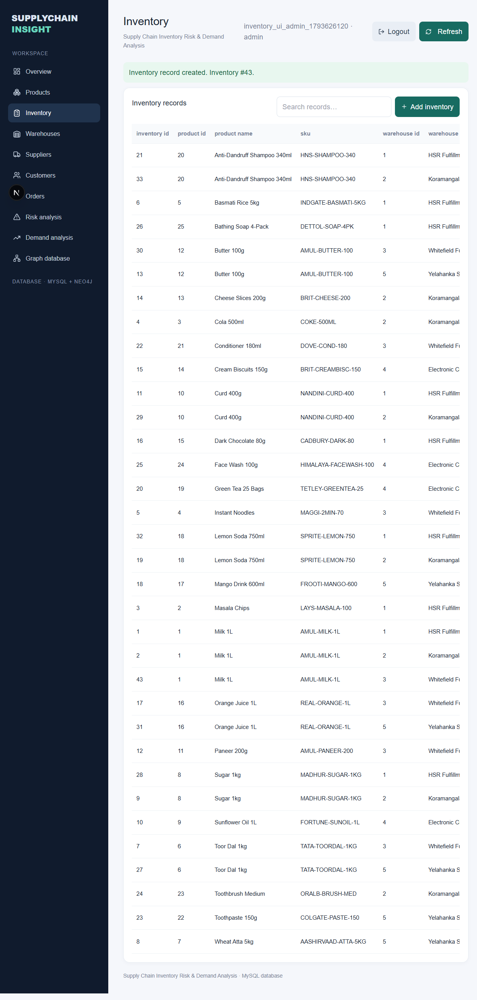

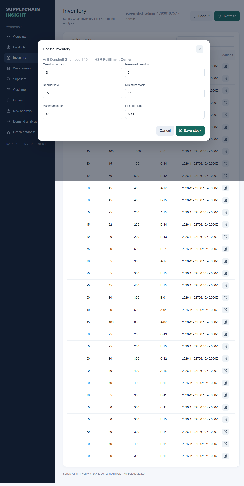

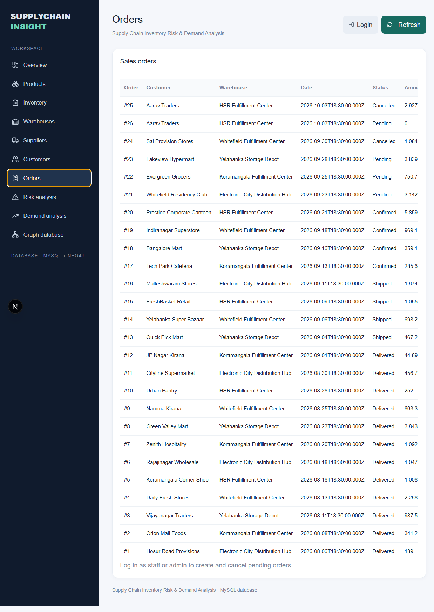

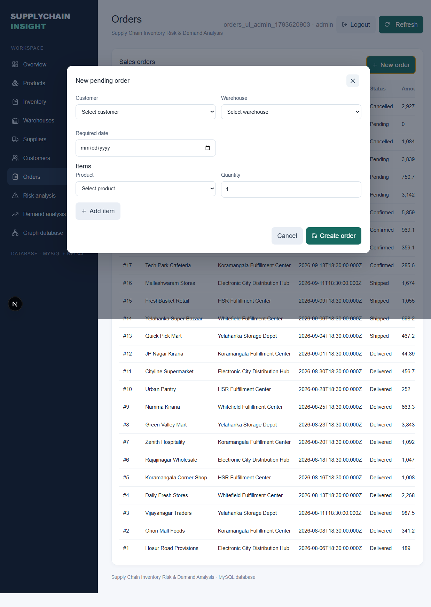

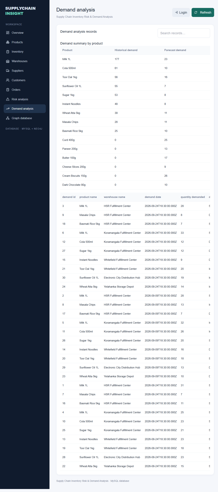

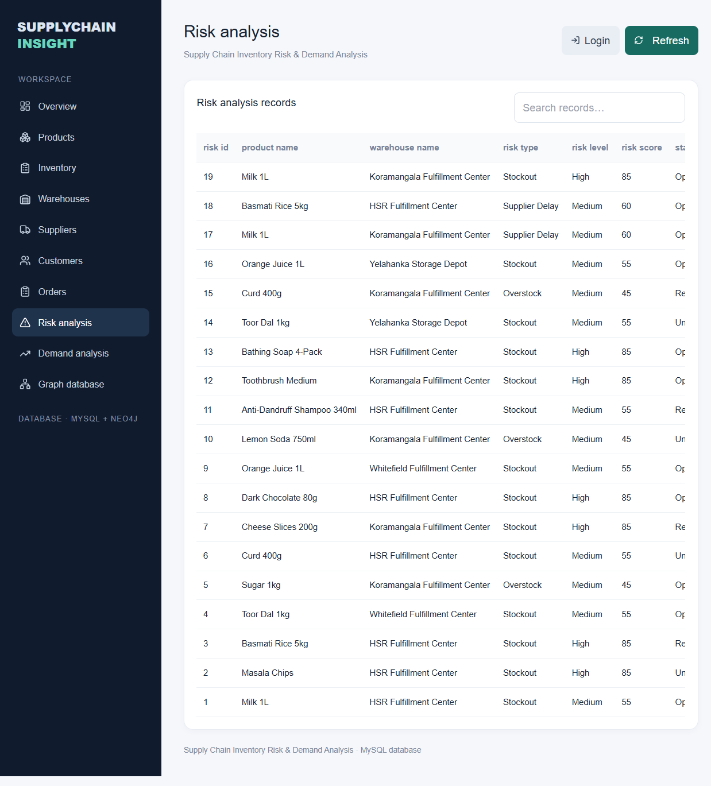

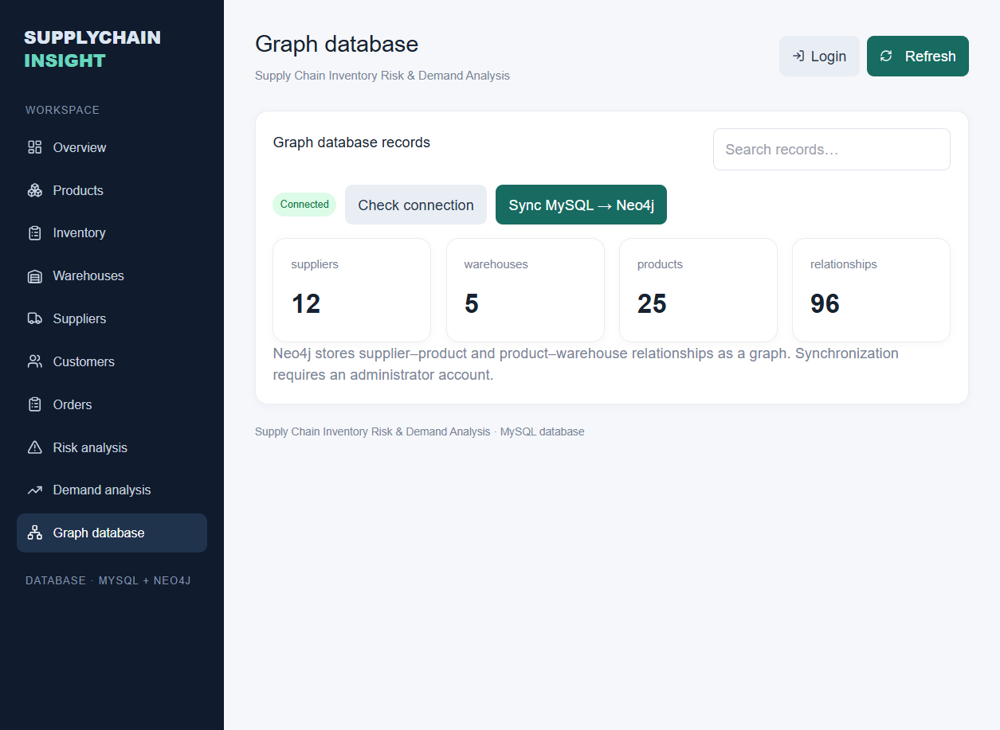

## Limitations and Submission Evidence

- Order lines cannot be edited after creation, and confirmation/shipment/delivery state transitions remain outside this UI. These need explicit fulfillment rules before implementation.
- The integration test used disposable records and removed them afterward. The database stock-check trigger was also exercised with a transaction rollback.
- The active project folder is not a Git repository. Add this report and implementation to the team's repository, then record real team members and individual contributions; do not invent attribution.
- Rotate the administrator password before submission because it was entered in a terminal command during setup and may remain in shell history.

## Individual Contributions

Complete this table with the team's actual names and work before submission.

| Team member | Contribution | Evidence |
| --- | --- | --- |
| TBD | TBD | Commit IDs, files, or screenshots |
| TBD | TBD | Commit IDs, files, or screenshots |