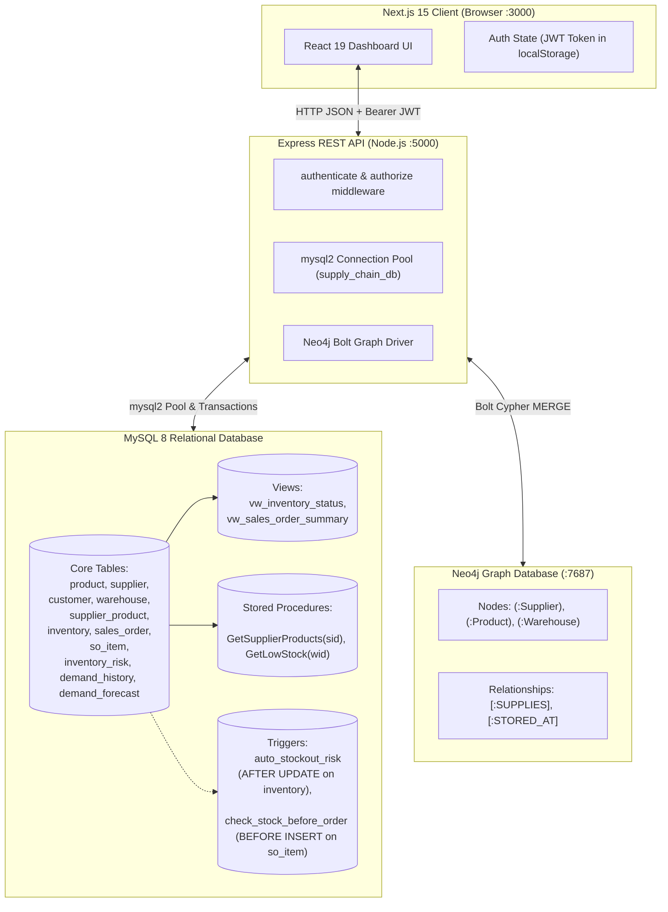

# Supply Chain Inventory & Demand Management
## Complete Page-by-Page System, Database, Trigger & Cascading Reference Guide

This document is a complete, authoritative reference explaining **what each page does**, **how to use that page**, **where it fetches data from**, **what it does to the database**, **what database triggers & procedures are executed**, and **how changes on that page cascade to and affect other pages and tables**.

---

## Table of Contents
1. [System Architecture & Roles](#system-architecture--roles)
2. [Global Navigation, Search & Authentication](#global-navigation-search--authentication)
3. [Page 1: Overview (Dashboard)](#page-1-overview-dashboard)
4. [Page 2: Products](#page-2-products)
5. [Page 3: Inventory](#page-3-inventory)
6. [Page 4: Warehouses](#page-4-warehouses)
7. [Page 5: Suppliers](#page-5-suppliers)
8. [Page 6: Supplier Products (Vendor-Product Catalog)](#page-6-supplier-products-vendor-product-catalog)
9. [Page 7: Customers](#page-7-customers)
10. [Page 8: Orders (Sales Orders & Stock Reservations)](#page-8-orders-sales-orders--stock-reservations)
11. [Page 9: Risk Analysis](#page-9-risk-analysis)
12. [Page 10: Demand Analysis](#page-10-demand-analysis)
13. [Page 11: Graph Database (Neo4j Relationship Network)](#page-11-graph-database-neo4j-relationship-network)
14. [Database Triggers & Stored Procedures Deep Dive](#database-triggers--stored-procedures-deep-dive)
15. [Master Cross-Page Trigger & Cascading Impact Matrix](#master-cross-page-trigger--cascading-impact-matrix)
16. [How to Run the Complete Project Cleanly](#how-to-run-the-complete-project-cleanly)

---

## System Architecture & Roles



### User Roles & Permissions
- **Public (Guest / Unauthenticated):** Read-only visibility across all 11 pages.
- **Staff (`role = 'staff'`):** Can create products, update products, add inventory records, adjust inventory stock levels, create suppliers, update suppliers, link products to suppliers, update supplier links, create customers, update customers, create sales orders, and cancel pending sales orders.
- **Admin (`role = 'admin'`):** All Staff privileges PLUS deleting products, unlinking supplier products, deleting suppliers, deleting customers, deleting cancelled orders, and synchronizing MySQL data into the Neo4j graph database.

---

## Global Navigation, Search & Authentication

### 1. Authentication (`LogIn` / `LogOut`)
- **How to Use:**
  1. Click the **Login** button (`LogIn` icon) in the upper right corner of the topbar.
  2. Enter credentials (e.g. Username: `admin`, Password: `adminpassword` or `staff` / `staffpassword`).
  3. Click **Sign in**.
- **From Where It Fetches:**
  - `POST /api/auth/login`
- **What It Does to the Database:**
  - Executes: `SELECT id, username, password_hash, role, is_active FROM app_users WHERE username = ? AND is_active = 1`
  - Verifies the password using bcrypt. If valid, signs and returns a signed JWT containing `{ id, username, role }`.
- **What It Triggers:**
  - Saves the token in `localStorage` (`sc_token`) and user object in `sc_user`.
  - Re-evaluates client permissions, enabling edit/delete/create buttons across all pages according to the user's role.

### 2. Live Topbar Search Engine
- **How to Use:**
  - Type any search term into the search bar at the top of the page.
  - Supports search by partial names, letters, numbers, formatted Indian Rupee amounts, `#ID`, and multi-word terms (e.g., `Aarav Wholesale`, `Milk Amul`, `Bangalore 560`).
- **How It Works Internally:**
  - Uses an exact value-based matcher that checks **only row cell values** (e.g., `"Aarav Traders"`, `450.00`, `"Wholesale"`), intentionally excluding JavaScript/JSON schema keys (`product_name`, `customer_id`, etc.) so that searching common letters like `a`, `c`, or `e` does not match every row in the table.
- **Search Placement:** Active on operational data pages (`Products`, `Inventory`, `Warehouses`, `Suppliers`, `Supplier Products`, `Customers`, `Orders`, `Risk analysis`). Intentionally hidden on analytical summaries (`Overview`, `Demand analysis`, `Graph database`) where row filtering does not apply.

### 3. Refresh Button (`RefreshCw` icon)
- **How to Use:** Click the circular refresh icon in the topbar.
- **What It Triggers:** Re-executes `GET /api/dashboard/stats` and the active page's table fetch simultaneously, updating live counts and table rows.

---

## Page 1: Overview (Dashboard)

### What the Page Does
Provides a live, high-level operational command center showing system-wide statistics (KPI cards), critical low-stock items that need urgent purchasing, recent sales orders, and a graphical stock health distribution bar chart.

### How to Use That Page
1. Click **Overview** in the left sidebar navigation.
2. Read the 8 key metrics on the top KPI cards:
   - **Products**: Total catalog count.
   - **Warehouses**: Active distribution centers.
   - **Suppliers**: Active supplier vendors.
   - **Customers**: Registered client accounts.
   - **Inventory records**: Total warehouse-product stock positions.
   - **Sales orders**: Lifetime sales orders placed.
   - **Low / critical stock**: Number of inventory positions at or below reorder level.
   - **Open inventory risks**: Unresolved risk entries.
3. Review the **Attention required** table: Displays items with status `'Critical'`, `'Low'`, or `'Overstock'`.
4. Review the **Recent sales orders** table: Shows the 7 latest customer orders with their statuses (`Pending`, `Confirmed`, `Shipped`, `Delivered`, `Cancelled`) and formatted amounts in INR (₹).
5. Review the **Inventory health snapshot** chart: A visual bar chart indicating current available quantities for top items needing attention.

### From Where It Fetches
- **API Route:** `GET /api/dashboard/stats`
- **Tables & Views Queried:**
  - `product` (`SELECT COUNT(*) FROM product`)
  - `warehouse` (`SELECT COUNT(*) FROM warehouse`)
  - `supplier` (`SELECT COUNT(*) FROM supplier`)
  - `customer` (`SELECT COUNT(*) FROM customer`)
  - `inventory` (`SELECT COUNT(*) FROM inventory`)
  - `sales_order` (`SELECT COUNT(*) FROM sales_order`)
  - `inventory_risk` (`SELECT COUNT(*) FROM inventory_risk WHERE status = 'Open'`)
  - `vw_inventory_status` (`SELECT COUNT(*) FROM vw_inventory_status WHERE stock_status IN ('Low', 'Critical')`)
  - `vw_sales_order_summary` (`SELECT * FROM vw_sales_order_summary ORDER BY order_date DESC, so_id DESC LIMIT 7`)
  - `vw_inventory_status` (`SELECT * FROM vw_inventory_status WHERE stock_status != 'Healthy' ORDER BY available_quantity ASC LIMIT 8`)

### What It Does to the Database
- Executes read-only `SELECT` count queries and view selections. No rows are inserted, updated, or locked.

### What It Triggers
- None (Read-only dashboard).

### Cascading Effects
- Reflects changes made on **any** other page. As soon as you add a product, place an order, adjust stock, or add a customer, clicking **Refresh** or returning to **Overview** immediately updates the metrics and tables.

---

## Page 2: Products

### What the Page Does
Manages the company's master catalog of sellable merchandise: product names, SKUs, categories, brands, barcodes, unit prices, and default reorder thresholds.

### How to Use That Page
1. Click **Products** in the left sidebar.
2. Filter products using the search bar (by product name, SKU, brand, category, or barcode).
3. **Add a Product (Staff / Admin):**
   - Click the green **Add product** button (`Plus` icon).
   - Enter Product Name (required), SKU (required, unique), Category (dropdown), Unit of Measure (dropdown), Brand, Barcode (unique), Unit Price, and Reorder Level.
   - Click **Save product**.
4. **Edit a Product (Staff / Admin):**
   - Click the **Edit** button (`Edit` icon) on any product row.
   - Modify fields in the modal and click **Save changes**.
5. **Delete a Product (Admin Only):**
   - Click the red **Delete** button (`Trash2` icon) on any product row.
   - Confirm deletion in the confirmation prompt.

### From Where It Fetches
- **Product List:** `GET /api/manage/products`
  - Query:
    ```sql
    SELECT p.product_id, p.product_name, p.sku, p.brand, p.barcode,
           p.unit_price, p.reorder_level, p.discontinued_flag,
           c.category_name, u.uom_name
    FROM product p
    JOIN category c ON p.category_id = c.category_id
    JOIN uom u ON p.uom_id = u.uom_id
    ORDER BY p.product_id DESC LIMIT 500
    ```
- **Category & UOM Lookups:** `GET /api/manage/lookups`
  - Queries `SELECT category_id, category_name FROM category` and `SELECT uom_id, uom_name FROM uom`.

### What It Does to the Database
- **Add Product:**
  - `POST /api/manage/products`
  - SQL:
    ```sql
    INSERT INTO product (category_id, uom_id, product_name, sku, brand, barcode, unit_price, reorder_level, discontinued_flag)
    VALUES (?, ?, ?, ?, ?, ?, ?, ?, ?)
    ```
  - Enforces `UNIQUE KEY uq_sku (sku)` and `UNIQUE KEY uq_barcode (barcode)`. If a duplicate SKU or barcode is entered, MySQL throws error `ER_DUP_ENTRY` (HTTP 409).
- **Edit Product:**
  - `PUT /api/manage/products/:id`
  - SQL:
    ```sql
    UPDATE product
    SET category_id=?, uom_id=?, product_name=?, sku=?, brand=?, barcode=?, unit_price=?, reorder_level=?, discontinued_flag=?
    WHERE product_id=?
    ```
- **Delete Product:**
  - `DELETE /api/manage/products/:id`
  - SQL:
    ```sql
    DELETE FROM product WHERE product_id = ?
    ```
  - If the product is referenced in `inventory`, `supplier_product`, or `so_item`, foreign key constraints prevent deletion and return HTTP 409 conflict.

### What It Triggers
- Enforces database constraints: `unit_price >= 0`, `reorder_level >= 0`, unique SKU, unique barcode.

### Cascading Effects to Other Pages & Tables
- **Overview:** Increments/decrements `totalProducts` count card.
- **Inventory Page:** New product immediately appears in the **Add Inventory** modal product dropdown.
- **Supplier Products Page:** Product immediately appears in the **Link Product to Supplier** modal dropdown.
- **Suppliers Page ("View Products" modal):** If linked to a supplier, appears when clicking the package icon on that supplier.
- **Orders Page:** Once added to inventory at a warehouse, becomes available for order lines in the **New Order** modal.
- **Graph Database:** On next Neo4j sync (`POST /api/neo4j/sync`), a new `(:Product)` node is created.

---

## Page 3: Inventory

### What the Page Does
Tracks stock positions across all warehouses: on-hand quantity, reserved quantity (committed to pending customer orders), available quantity for new orders, reorder thresholds, minimum & maximum stock limits, and warehouse aisle/shelf location slots.

### How to Use That Page
1. Click **Inventory** in the sidebar.
2. Filter inventory by product name, warehouse name, SKU, or location slot.
3. **Add an Inventory Position (Staff / Admin):**
   - Click the green **Add inventory** button (`Plus` icon).
   - Select a Warehouse and a Product (dropdown automatically disables already-stocked combinations to prevent duplicates).
   - Enter Quantity On Hand, Reserved Quantity (default 0), Reorder Level, Min Stock Level, Max Stock Level, and Location Slot (e.g. `A-12-03`).
   - Click **Save inventory**.
4. **Update Stock Levels (Staff / Admin):**
   - Click the **Update stock** button (`Edit` icon) on any inventory row.
   - Adjust `Quantity on hand`, `Reserved quantity`, `Reorder level`, `Min stock level`, `Max stock level`, or `Location slot`.
   - Click **Save changes**.

### From Where It Fetches
- **Inventory List:** `GET /api/manage/inventory`
  - Query:
    ```sql
    SELECT i.inventory_id, i.product_id, i.warehouse_id,
           p.product_name, p.sku, w.warehouse_name,
           i.quantity_on_hand, i.reserved_quantity,
           (i.quantity_on_hand - i.reserved_quantity) AS available_quantity,
           i.reorder_level, i.min_stock_level, i.max_stock_level,
           i.location_slot, i.last_counted_date
    FROM inventory i
    JOIN product p ON i.product_id = p.product_id
    JOIN warehouse w ON i.warehouse_id = w.warehouse_id
    ORDER BY i.inventory_id DESC LIMIT 500
    ```
- **Inventory Lookups:** `GET /api/manage/inventory-lookups`
  - Queries active products, warehouses, and existing `(product_id, warehouse_id)` pairs.

### What It Does to the Database
- **Add Inventory:**
  - `POST /api/manage/inventory`
  - Transaction:
    ```sql
    START TRANSACTION;
    SELECT inventory_id FROM inventory WHERE product_id = ? AND warehouse_id = ? FOR UPDATE;
    -- Validates no duplicate exists and constraints:
    -- reserved_quantity <= quantity_on_hand
    -- min_stock_level <= max_stock_level
    INSERT INTO inventory (product_id, warehouse_id, quantity_on_hand, reserved_quantity,
                           reorder_level, min_stock_level, max_stock_level, location_slot, last_counted_date)
    VALUES (?, ?, ?, ?, ?, ?, ?, ?, CURDATE());
    COMMIT;
    ```
- **Update Inventory:**
  - `PATCH /api/manage/inventory/:id`
  - Transaction:
    ```sql
    START TRANSACTION;
    SELECT * FROM inventory WHERE inventory_id = ? FOR UPDATE;
    UPDATE inventory
    SET quantity_on_hand = ?, reserved_quantity = ?, reorder_level = ?,
        min_stock_level = ?, max_stock_level = ?, location_slot = ?, last_counted_date = CURDATE()
    WHERE inventory_id = ?;
    COMMIT;
    ```

### What It Triggers
- **MySQL Trigger `auto_stockout_risk` (AFTER UPDATE ON inventory):**
  - When `(NEW.quantity_on_hand - NEW.reserved_quantity) <= NEW.min_stock_level` and there is no existing open stockout risk:
    - If `available_quantity <= 0`: sets `risk_score = 100`, `risk_level = 'Critical'`.
    - If `available_quantity <= min_stock_level`: sets `risk_score = 85`, `risk_level = 'High'`.
    - Automatically executes:
      ```sql
      INSERT INTO inventory_risk
      (inventory_id, detected_date, risk_type, risk_level, risk_score, status, recommended_action, threshold_value)
      VALUES (NEW.inventory_id, CURDATE(), 'Stockout',
              IF(v_score >= 90, 'Critical', 'High'), v_score, 'Open',
              'Raise purchase order with preferred supplier', NEW.min_stock_level);
      ```

### Cascading Effects to Other Pages & Tables
- **Overview:**
  - Updates `inventoryRecords` KPI count.
  - Updates `lowStock` count (queried from `vw_inventory_status`).
  - Updates **Attention required** table and **Inventory health snapshot** chart.
- **Risk Analysis Page:**
  - If stock drops below minimum, `auto_stockout_risk` creates an **Open** risk row that instantly appears on the Risk Analysis page!
- **Orders Page:**
  - The maximum quantity that can be ordered for this product at this warehouse is dynamically limited by `available_quantity`.
  - During order placement, MySQL trigger `check_stock_before_order` verifies this inventory record.
- **Graph Database:**
  - Next Neo4j sync updates the `[:STORED_AT]` relationship with new available and reserved quantities.

---

## Page 4: Warehouses

### What the Page Does
Displays distribution facilities, physical street addresses, storage capacities (in sq. ft. or pallet capacity), and operational statuses.

### How to Use That Page
1. Click **Warehouses** in the sidebar.
2. Filter warehouses using the search bar (by warehouse name, city/state, address, or capacity).
3. View warehouse capacity and operational active status.

### From Where It Fetches
- **API Route:** `GET /api/data/warehouses`
- **Query:**
  ```sql
  SELECT warehouse_id, warehouse_name, location, address, capacity, is_active
  FROM warehouse
  ORDER BY warehouse_name DESC
  ```

### What It Does to the Database
- Executes read-only `SELECT` query.

### What It Triggers
- Stored procedure `GetLowStock(wid)` is available for querying low stock specific to any warehouse.

### Cascading Effects to Other Pages & Tables
- Warehouses serve as the physical container for inventory items (`inventory.warehouse_id`), fulfillment origins for sales orders (`sales_order.warehouse_id`), and nodes in the Neo4j graph `(:Warehouse)`.

---

## Page 5: Suppliers

### What the Page Does
Manages commercial vendor partners: company names, primary contact people, emails, phone numbers, facility addresses, performance ratings (0.0 to 5.0), and active supplier status. Provides direct access to view all products supplied by any vendor.

### How to Use That Page
1. Click **Suppliers** in the sidebar.
2. Filter suppliers using the search bar (by company name, contact person, email, phone, address, or rating).
3. **View Products Supplied by This Supplier:**
   - Click the blue **View supplied products** button (`Package` icon) on any supplier row.
   - An interactive modal appears calling stored procedure `CALL GetSupplierProducts(?)`, displaying product names, unit costs, lead times, and preferred vendor status.
4. **Add a Supplier (Staff / Admin):**
   - Click the green **Add supplier** button (`Plus` icon).
   - Enter Supplier Name (required), Contact Person, Email, Phone Number, Address, and Rating (0.0 to 5.0).
   - Click **Save supplier**.
5. **Edit a Supplier (Staff / Admin):**
   - Click the **Edit** button (`Edit` icon) on any supplier row.
   - Update fields in the modal and click **Save changes**.
6. **Delete a Supplier (Admin Only):**
   - Click the red **Delete** button (`Trash2` icon) on any supplier row.
   - Confirm deletion. If the supplier is linked to products (`supplier_product`) or purchase orders (`purchase_order`), MySQL blocks deletion with an explanatory error.

### From Where It Fetches
- **Supplier List:** `GET /api/manage/suppliers`
  - Query:
    ```sql
    SELECT supplier_id, supplier_name, contact_person, email, phone_number, address, rating, is_active
    FROM supplier
    ORDER BY supplier_id DESC LIMIT 500
    ```
- **Supplier Products Modal:** `GET /api/manage/suppliers/:id/products`
  - Executes stored procedure:
    ```sql
    CALL GetSupplierProducts(?)
    ```

### What It Does to the Database
- **Add Supplier:**
  - `POST /api/manage/suppliers`
  - SQL:
    ```sql
    INSERT INTO supplier (supplier_name, contact_person, email, phone_number, address, rating, is_active)
    VALUES (?, ?, ?, ?, ?, ?, 1)
    ```
  - Enforces `chk_supplier_rating` check constraint (`rating >= 0 AND rating <= 5`).
- **Edit Supplier:**
  - `PUT /api/manage/suppliers/:id`
  - SQL:
    ```sql
    UPDATE supplier
    SET supplier_name=?, contact_person=?, email=?, phone_number=?, address=?, rating=?, is_active=?
    WHERE supplier_id=?
    ```
- **Delete Supplier:**
  - `DELETE /api/manage/suppliers/:id`
  - SQL:
    ```sql
    DELETE FROM supplier WHERE supplier_id=?
    ```
  - Enforces foreign key constraints.

### What It Triggers
- When viewing a supplier's products, executes MySQL stored procedure `GetSupplierProducts(sid)`:
  ```sql
  SELECT s.supplier_name, p.product_name, sp.unit_cost, sp.lead_time_days, sp.is_preferred
  FROM supplier_product sp
  JOIN supplier s ON sp.supplier_id = s.supplier_id
  JOIN product p  ON sp.product_id = p.product_id
  WHERE sp.supplier_id = sid;
  ```

### Cascading Effects to Other Pages & Tables
- **Overview:** Increments `totalSuppliers` count card.
- **Supplier Products Page:** New supplier immediately appears in the supplier dropdown for product linking.
- **Graph Database:** Next Neo4j sync reads the supplier and creates a `(:Supplier)` graph node.

---

## Page 6: Supplier Products (Vendor-Product Catalog)

### What the Page Does
Implements the relational bridge connecting **Suppliers to Products** based on the `supplier_product` table in `backup.sql`. Tracks which suppliers supply which products, agreed unit purchase costs, delivery lead times (in days), vendor product codes, and whether the supplier is the "Preferred" vendor for that product.

### How to Use That Page
1. Click **Supplier Products** (`Link2` icon) in the sidebar.
2. Filter records using the search bar (by supplier name, product name, SKU, vendor product code, or preferred status).
3. **Link a Product to a Supplier (Staff / Admin):**
   - Click the green **Link product** button (`Plus` icon).
   - In the modal:
     - Select a **Supplier** from the dropdown.
     - Select a **Product** from the dropdown (existing pairs are automatically disabled to prevent duplicate keys).
     - Enter **Unit Cost** (₹, >= 0).
     - Enter **Lead Time (days)** (>= 0).
     - Enter optional **Supplier Product Code** (vendor SKU).
     - Check **Set as preferred supplier** if applicable.
   - Click **Save link**.
4. **Edit Supplier-Product Pricing / Lead Time (Staff / Admin):**
   - Click the **Edit** button (`Edit` icon) on any row.
   - Modify Unit Cost, Lead Time, Supplier Product Code, or Preferred status.
   - Click **Save changes**.
5. **Unlink Product from Supplier (Admin Only):**
   - Click the red **Unlink** button (`Trash2` icon) on any row.
   - Confirm deletion to remove the supplier-product association.

### From Where It Fetches
- **Supplier-Product Grid:** `GET /api/manage/supplier-products`
  - Query:
    ```sql
    SELECT sp.supplier_product_id, sp.supplier_id, s.supplier_name,
           sp.product_id, p.product_name, p.sku, p.brand,
           sp.supplier_product_code, sp.unit_cost, sp.lead_time_days, sp.is_preferred
    FROM supplier_product sp
    JOIN supplier s ON s.supplier_id = sp.supplier_id
    JOIN product p ON p.product_id = sp.product_id
    ORDER BY s.supplier_name, p.product_name LIMIT 500
    ```
- **Lookup Pairs:** `GET /api/manage/supplier-product-lookups`
  - Queries active suppliers, active products, and existing `(supplier_id, product_id)` pairs.

### What It Does to the Database
- **Link Product to Supplier:**
  - `POST /api/manage/supplier-products`
  - SQL:
    ```sql
    INSERT INTO supplier_product
    (supplier_id, product_id, supplier_product_code, unit_cost, lead_time_days, is_preferred)
    VALUES (?, ?, ?, ?, ?, ?)
    ```
  - Enforces `UNIQUE KEY uq_supplier_product (supplier_id, product_id)`.
  - Enforces `unit_cost >= 0` and `lead_time_days >= 0`.
- **Update Link:**
  - `PUT /api/manage/supplier-products/:id`
  - SQL:
    ```sql
    UPDATE supplier_product
    SET supplier_product_code=?, unit_cost=?, lead_time_days=?, is_preferred=?
    WHERE supplier_product_id=?
    ```
- **Unlink Product:**
  - `DELETE /api/manage/supplier-products/:id`
  - SQL:
    ```sql
    DELETE FROM supplier_product WHERE supplier_product_id=?
    ```

### What It Triggers
- Enforces table constraints from `backup.sql`:
  - `chk_sp_cost`: `CHECK (unit_cost >= 0)`
  - `chk_sp_lead`: `CHECK (lead_time_days >= 0)`
  - `uq_supplier_product`: `UNIQUE KEY (supplier_id, product_id)`

### Cascading Effects to Other Pages & Tables
- **Suppliers Page ("View Products" modal):** Newly linked products immediately appear when opening the package icon on that supplier (via `CALL GetSupplierProducts(?)`).
- **Graph Database (Neo4j):** Next Neo4j sync reads `supplier_product` and constructs the graph edge:
  ```cypher
  MERGE (s:Supplier {id: row.supplier_id})-[r:SUPPLIES]->(p:Product {id: row.product_id})
  SET r.unit_cost = row.unit_cost, r.lead_time_days = row.lead_time_days, r.preferred = row.is_preferred
  ```
- **Risk Analysis & Purchase Orders:** Recommended actions on risk items ("Raise purchase order with preferred supplier") reference the preferred vendor established in this table.

---

## Page 7: Customers

### What the Page Does
Manages client accounts purchasing products: customer names, email addresses, phone numbers, client classification (`Retail`, `Wholesale`, `Corporate`), street addresses, and account status.

### How to Use That Page
1. Click **Customers** in the sidebar.
2. Filter customers using the search bar (by customer name, email, phone, customer type, or address).
3. **Add a Customer (Staff / Admin):**
   - Click the green **Add customer** button (`Plus` icon).
   - In the modal, enter Customer Name (required), Email (required, valid email pattern), Customer Type (`Retail`, `Wholesale`, `Corporate`), Phone Number, and Address.
   - Click **Save customer**.
4. **Edit a Customer (Staff / Admin):**
   - Click the **Edit** button (`Edit` icon) on any customer row.
   - Update fields and click **Save changes**.
5. **Delete a Customer (Admin Only):**
   - Click the red **Delete** button (`Trash2` icon) on any customer row.
   - Confirm deletion. If the customer has existing sales orders (`sales_order`), MySQL blocks deletion with HTTP 409 conflict.

### From Where It Fetches
- **Customer List:** `GET /api/manage/customers`
  - Query:
    ```sql
    SELECT customer_id, customer_name, email, phone_number, customer_type, address, is_active
    FROM customer
    ORDER BY customer_id DESC LIMIT 500
    ```

### What It Does to the Database
- **Add Customer:**
  - `POST /api/manage/customers`
  - SQL:
    ```sql
    INSERT INTO customer (customer_name, email, address, customer_type, phone_number, is_active)
    VALUES (?, ?, ?, ?, ?, 1)
    ```
  - Enforces `chk_cust_type` (`customer_type IN ('Retail', 'Wholesale', 'Corporate')`).
  - Enforces `chk_cust_email` (`email LIKE '%_@_%._%'`).
  - Enforces `UNIQUE KEY uq_customer_email (email)` and `UNIQUE KEY uq_customer_phone (phone_number)`.
- **Edit Customer:**
  - `PUT /api/manage/customers/:id`
  - SQL:
    ```sql
    UPDATE customer
    SET customer_name=?, email=?, address=?, customer_type=?, phone_number=?, is_active=?
    WHERE customer_id=?
    ```
- **Delete Customer:**
  - `DELETE /api/manage/customers/:id`
  - SQL:
    ```sql
    DELETE FROM customer WHERE customer_id=?
    ```

### What It Triggers
- Database integrity checks on email format, customer classification, and foreign keys.

### Cascading Effects to Other Pages & Tables
- **Overview:** Increments `totalCustomers` count card.
- **Orders Page:** Newly added customer is **immediately available** in the customer selection dropdown when creating a new sales order (`GET /api/manage/order-lookups` queries `SELECT customer_id, customer_name FROM customer ORDER BY customer_name`).

---

## Page 8: Orders (Sales Orders & Stock Reservations)

### What the Page Does
Complete sales order processing and inventory allocation ledger: order creation, real-time stock reservation, cancellation, and order deletion.

### How to Use That Page
1. Click **Orders** in the sidebar.
2. Filter orders using the search bar (by Order ID e.g. `#105` or `105`, Customer name, Warehouse name, Status, or Total Amount).
3. **Create a New Sales Order (Staff / Admin):**
   - Click the green **New order** button (`Plus` icon).
   - In the modal:
     - Select **Customer** (from customer table).
     - Select **Fulfillment Warehouse** (from warehouse table).
     - Select **Required Delivery Date** (cannot be in the past).
     - Add order items:
       - The product dropdown **only shows products stocked at the selected warehouse**.
       - The UI displays `Available: X` and automatically caps the quantity input at `X`.
       - Click **+ Add another product** to include multiple items in one order.
     - Review live calculated line totals and order subtotal.
   - Click **Submit order**.
4. **Cancel a Pending Order (Staff / Admin):**
   - Click the red **Cancel order** button (`X` icon) on any order with status `'Pending'`.
   - Confirm cancellation.
5. **Delete a Cancelled Order (Admin Only):**
   - Click the red **Delete order** button (`Trash2` icon) on any cancelled order.

### From Where It Fetches
- **Orders List:** `GET /api/manage/orders`
  - Query:
    ```sql
    SELECT summary.so_id, summary.customer_name, summary.warehouse_name,
           summary.order_date, summary.status, summary.total_items,
           summary.total_amount, managed.managed_by
    FROM vw_sales_order_summary summary
    LEFT JOIN app_managed_orders managed ON summary.so_id = managed.so_id
    ORDER BY summary.so_id DESC LIMIT 500
    ```
- **Order Lookups:** `GET /api/manage/order-lookups`
  - Queries active customers, active warehouses, active products, and live available stock per warehouse:
    ```sql
    SELECT i.warehouse_id, i.product_id, (i.quantity_on_hand - i.reserved_quantity) AS available_quantity
    FROM inventory i
    JOIN product p ON i.product_id = p.product_id
    WHERE (i.quantity_on_hand - i.reserved_quantity) > 0
    ```

### What It Does to the Database
- **Create Order (Strict ACID Transaction):**
  - `POST /api/manage/orders`
  - Steps executed inside a single transaction:
    ```sql
    START TRANSACTION;
    -- 1. Row-lock inventory rows to prevent race conditions:
    SELECT inventory_id, quantity_on_hand, reserved_quantity, (quantity_on_hand - reserved_quantity) AS available
    FROM inventory
    WHERE product_id = ? AND warehouse_id = ? FOR UPDATE;

    -- 2. Insert into sales_order:
    INSERT INTO sales_order (customer_id, warehouse_id, order_date, required_date, status, total_amount)
    VALUES (?, ?, CURDATE(), ?, 'Pending', ?);

    -- 3. Record managing user:
    INSERT INTO app_managed_orders (so_id, managed_by) VALUES (?, ?);

    -- 4. Insert each order item into so_item:
    -- (This triggers check_stock_before_order!)
    INSERT INTO so_item (so_id, product_id, quantity, unit_price, line_total)
    VALUES (?, ?, ?, ?, ?);

    -- 5. Reserve warehouse inventory:
    UPDATE inventory
    SET reserved_quantity = reserved_quantity + ?
    WHERE product_id = ? AND warehouse_id = ?;

    -- 6. Record reservation audit record:
    INSERT INTO app_order_reservations (so_id, inventory_id, reserved_quantity, released)
    VALUES (?, ?, ?, FALSE);

    COMMIT;
    ```
- **Cancel Order (Strict ACID Transaction):**
  - `POST /api/manage/orders/:id/cancel`
  - Steps executed inside transaction:
    ```sql
    START TRANSACTION;
    SELECT * FROM sales_order WHERE so_id = ? FOR UPDATE;
    SELECT * FROM app_order_reservations WHERE so_id = ? AND released = FALSE FOR UPDATE;

    -- Decrement inventory reserved quantity (restoring available stock):
    UPDATE inventory
    SET reserved_quantity = reserved_quantity - ?
    WHERE inventory_id = ?;

    -- Mark reservation released:
    UPDATE app_order_reservations SET released = TRUE WHERE so_id = ?;

    -- Update order status:
    UPDATE sales_order SET status = 'Cancelled' WHERE so_id = ?;

    COMMIT;
    ```
- **Delete Order:**
  - `DELETE /api/manage/orders/:id`
  - Deletes records from `app_managed_orders`, `so_item`, and `sales_order`.

### What It Triggers
1. **MySQL Trigger `check_stock_before_order` (BEFORE INSERT ON `so_item`):**
   - Automatically computes `v_available = (quantity_on_hand - reserved_quantity)` from `inventory` for the order's warehouse.
   - If `NEW.quantity > v_available`, MySQL aborts the insert with:
     `SIGNAL SQLSTATE '45000' SET MESSAGE_TEXT = 'Insufficient stock available in warehouse'`.
2. **View `vw_sales_order_summary`:**
   - Automatically aggregates `count(so_item_id)` and order total for the order list.

### Cascading Effects to Other Pages & Tables
- **Inventory Page:**
  - When an order is placed, `reserved_quantity` increases and `available_quantity` decreases by that exact amount.
  - When an order is cancelled, `reserved_quantity` decreases and `available_quantity` is immediately restored.
- **Overview Page:**
  - Increments `salesOrders` KPI card.
  - New order immediately appears at the top of the **Recent sales orders** table.
  - If reserving stock reduces available quantity to Low/Critical, updates the **Attention required** table and **Low / critical stock** count.
- **Risk Analysis Page:**
  - If reserving stock drives available quantity below `min_stock_level`, trigger `auto_stockout_risk` opens a new stockout risk row.

---

## Page 9: Risk Analysis

### What the Page Does
Monitors supply chain disruptions, safety stock breaches, lead-time supplier delays, and stockout hazards.

### How to Use That Page
1. Click **Risk analysis** in the sidebar.
2. Read the top summary metrics: Total Risks, Open Risks, Critical Risks, High Risks.
3. Filter risks using the search bar (by product name, warehouse name, risk type, risk level, status, or recommended action).
4. Review the recommended mitigation actions (e.g. "Raise purchase order with preferred supplier").

### From Where It Fetches
- **API Route:** `GET /api/analytics/risk-summary`
- **Query:**
  ```sql
  SELECT ir.risk_id, p.product_name, w.warehouse_name,
         ir.risk_type, ir.risk_level, ir.risk_score,
         ir.detected_date, ir.status, ir.recommended_action
  FROM inventory_risk ir
  JOIN inventory i ON ir.inventory_id = i.inventory_id
  JOIN product p ON i.product_id = p.product_id
  JOIN warehouse w ON i.warehouse_id = w.warehouse_id
  ORDER BY ir.risk_score DESC, ir.detected_date DESC LIMIT 500
  ```

### What It Does to the Database
- Reads risk summaries and table rows.

### What It Triggers
- Enforces table check constraint `chk_risk_status`:
  `CHECK (status IN ('Open', 'Under Review', 'Resolved'))`.

### Cascading Effects
- Reflects automated entries inserted by the `auto_stockout_risk` trigger when inventory is adjusted or when customer orders reserve stock below safety thresholds.

---

## Page 10: Demand Analysis

### What the Page Does
Compares historical sales demand patterns against future demand forecasts, helping procurement teams project replenishments and spot demand spikes.

### How to Use That Page
1. Click **Demand analysis** in the sidebar.
2. Review the **Demand Summary by Product** table:
   - Compares total historical quantity demanded vs forecasted projected demand for each product.
3. Review the **Recent Demand History** table:
   - Displays chronological demand records showing product, warehouse, demand date, quantity demanded, and demand trend.

### From Where It Fetches
- **API Route:** `GET /api/analytics/demand`
- **Queries:**
  - `demand_history`:
    ```sql
    SELECT dh.demand_id, p.product_name, w.warehouse_name,
           dh.demand_date, dh.quantity_demanded, dh.demand_trend
    FROM demand_history dh
    JOIN product p ON dh.product_id = p.product_id
    JOIN warehouse w ON dh.warehouse_id = w.warehouse_id
    ORDER BY dh.demand_date DESC LIMIT 100
    ```
  - `demand_forecast`:
    ```sql
    SELECT df.forecast_id, p.product_name, w.warehouse_name,
           df.forecast_date, df.forecasted_quantity, df.confidence_level
    FROM demand_forecast df
    JOIN product p ON df.product_id = p.product_id
    JOIN warehouse w ON df.warehouse_id = w.warehouse_id
    ORDER BY df.forecast_date DESC LIMIT 100
    ```
  - Summary aggregation query combining demand and forecast sums grouped by product.

### What It Does to the Database
- Executes analytical read-only joins and aggregations.

### Cascading Effects
- Analytical view reflecting consumption data across warehouses.

---

## Page 11: Graph Database (Neo4j Relationship Network)

### What the Page Does
Models multi-tier supply chain dependencies as a property graph: Suppliers, Products, and Warehouses connected by `[:SUPPLIES]` and `[:STORED_AT]` relationships.

### How to Use That Page
1. Click **Graph database** in the sidebar.
2. Check Neo4j connection status (Green = Connected, Red = Disconnected).
3. Click **Check connection** to verify connectivity with Neo4j Bolt port `7687`.
4. Click **Sync MySQL -> Neo4j (Admin Only)**:
   - Extracts all suppliers, products, warehouses, supplier-product links, and inventory records from MySQL.
   - Merges them into Neo4j graph nodes and relationships.
   - Shows live counts of nodes and relationships synchronized.

### From Where It Fetches
- **Status & Summary:** `GET /api/neo4j/summary`
  - Queries Neo4j Cypher:
    ```cypher
    MATCH (s:Supplier) WITH count(s) as suppliers
    MATCH (p:Product) WITH suppliers, count(p) as products
    MATCH (w:Warehouse) WITH suppliers, products, count(w) as warehouses
    MATCH ()-[r]->() WITH suppliers, products, warehouses, count(r) as relationships
    RETURN suppliers, products, warehouses, relationships
    ```

### What It Does to the Database
- **Sync Route:** `POST /api/neo4j/sync` (Admin authenticated)
  1. Reads MySQL records:
     - `SELECT supplier_id, supplier_name, rating, is_active FROM supplier`
     - `SELECT product_id, product_name, sku FROM product`
     - `SELECT warehouse_id, warehouse_name FROM warehouse`
     - `SELECT supplier_id, product_id, unit_cost, lead_time_days, is_preferred FROM supplier_product`
     - `SELECT product_id, warehouse_id, quantity_on_hand, reserved_quantity FROM inventory`
  2. Executes Cypher in Neo4j:
     ```cypher
     CREATE CONSTRAINT IF NOT EXISTS FOR (s:Supplier) REQUIRE s.id IS UNIQUE;
     CREATE CONSTRAINT IF NOT EXISTS FOR (p:Product) REQUIRE p.id IS UNIQUE;
     CREATE CONSTRAINT IF NOT EXISTS FOR (w:Warehouse) REQUIRE w.id IS UNIQUE;

     MERGE (s:Supplier {id: row.supplier_id})
     SET s.name = row.supplier_name, s.rating = row.rating, s.active = row.is_active;

     MERGE (p:Product {id: row.product_id})
     SET p.name = row.product_name, p.sku = row.sku;

     MERGE (w:Warehouse {id: row.warehouse_id})
     SET w.name = row.warehouse_name;

     MERGE (s)-[r:SUPPLIES]->(p)
     SET r.unit_cost = row.unit_cost, r.lead_time_days = row.lead_time_days, r.preferred = row.is_preferred;

     MERGE (p)-[r:STORED_AT]->(w)
     SET r.quantity_on_hand = row.quantity_on_hand, r.reserved = row.reserved_quantity, r.available = row.available;
     ```

### Cascading Effects
- Translates the entire relational state of MySQL into an interconnected graph for graph analytics and vendor dependency traversal.

---

## Database Triggers & Stored Procedures Deep Dive

### 1. Trigger: `auto_stockout_risk`
- **Timing & Event:** `AFTER UPDATE ON inventory FOR EACH ROW`
- **Logic:**
  ```sql
  IF (NEW.quantity_on_hand - NEW.reserved_quantity) <= NEW.min_stock_level
     AND NOT EXISTS (SELECT 1 FROM inventory_risk
                     WHERE inventory_id = NEW.inventory_id
                       AND risk_type = 'Stockout'
                       AND status = 'Open') THEN

      IF (NEW.quantity_on_hand - NEW.reserved_quantity) <= 0 THEN
          SET v_score = 100;
      ELSE
          SET v_score = 85;
      END IF;

      INSERT INTO inventory_risk
      (inventory_id, detected_date, risk_type, risk_level, risk_score, status, recommended_action, threshold_value)
      VALUES
      (NEW.inventory_id, CURDATE(), 'Stockout',
       IF(v_score >= 90, 'Critical', 'High'), v_score, 'Open',
       'Raise purchase order with preferred supplier', NEW.min_stock_level);
  END IF;
  ```
- **Fired By:** Modifying stock in the **Inventory** page or creating an order in the **Orders** page.

### 2. Trigger: `check_stock_before_order`
- **Timing & Event:** `BEFORE INSERT ON so_item FOR EACH ROW`
- **Logic:**
  ```sql
  SELECT warehouse_id INTO v_warehouse FROM sales_order WHERE so_id = NEW.so_id;
  SELECT COALESCE(SUM(quantity_on_hand - reserved_quantity), 0) INTO v_available
  FROM inventory
  WHERE product_id = NEW.product_id AND warehouse_id = v_warehouse;

  IF NEW.quantity > v_available THEN
      SIGNAL SQLSTATE '45000'
      SET MESSAGE_TEXT = 'Insufficient stock available in warehouse';
  END IF;
  ```
- **Fired By:** Inserting an order item during order placement on the **Orders** page.

### 3. Stored Procedure: `GetSupplierProducts(IN sid INT)`
- **Definition:**
  ```sql
  CREATE PROCEDURE `GetSupplierProducts`(IN sid INT)
  BEGIN
      SELECT
          s.supplier_name,
          p.product_name,
          sp.unit_cost,
          sp.lead_time_days,
          sp.is_preferred
      FROM supplier_product sp
      JOIN supplier s ON sp.supplier_id = s.supplier_id
      JOIN product p  ON sp.product_id = p.product_id
      WHERE sp.supplier_id = sid;
  END
  ```
- **Fired By:** Clicking the **View supplied products** button (`Package` icon) on the **Suppliers** page.

### 4. Stored Procedure: `GetLowStock(IN wid INT)`
- **Definition:**
  ```sql
  CREATE PROCEDURE `GetLowStock`(IN wid INT)
  BEGIN
      SELECT
          i.inventory_id,
          p.product_name,
          i.quantity_on_hand,
          i.reserved_quantity,
          (i.quantity_on_hand - i.reserved_quantity) AS available_quantity,
          i.reorder_level
      FROM inventory i
      JOIN product p ON i.product_id = p.product_id
      WHERE i.warehouse_id = wid
        AND (i.quantity_on_hand - i.reserved_quantity) <= i.reorder_level;
  END
  ```
- **Fired By:** Warehouse inventory threshold queries.

---

## Master Cross-Page Trigger & Cascading Impact Matrix

| Action / Trigger | Source Page | Database Execution | What Other Pages & Tables Are Affected |
| :--- | :--- | :--- | :--- |
| **Add Product** | `Products` | `INSERT INTO product` | - **Overview**: `totalProducts` KPI increments.<br>- **Inventory**: Product immediately selectable in Add Inventory dropdown.<br>- **Supplier Products**: Product selectable in Link Product dropdown.<br>- **Orders**: Available in order items once stocked.<br>- **Graph**: Synced as `(:Product)` node on next graph sync. |
| **Add Inventory** | `Inventory` | Transaction: `INSERT INTO inventory` | - **Overview**: `inventoryRecords` KPI increments.<br>- **Orders**: Product stock becomes available for fulfillment at that warehouse.<br>- **Graph**: Synced as `[:STORED_AT]` edge. |
| **Update Stock** | `Inventory` | `UPDATE inventory`, fires `auto_stockout_risk` | - **Overview**: Updates `lowStock` count, **Attention required** table, and **Snapshot** chart.<br>- **Orders**: Available quantity ceiling changes.<br>- **Risk Analysis**: Automatically creates **Open** risk row if stock falls below minimum. |
| **Add Supplier** | `Suppliers` | `INSERT INTO supplier` | - **Overview**: `totalSuppliers` KPI increments.<br>- **Supplier Products**: Supplier immediately selectable in Link Product dropdown.<br>- **Graph**: Synced as `(:Supplier)` node. |
| **Link Product to Supplier** | `Supplier Products` | `INSERT INTO supplier_product` | - **Suppliers**: Immediately visible when clicking **View supplied products** (`GetSupplierProducts`).<br>- **Graph**: Synced as `[:SUPPLIES]` relationship with unit cost and lead time.<br>- **Risk**: Connects preferred vendor for mitigation purchase orders. |
| **Add Customer** | `Customers` | `INSERT INTO customer` | - **Overview**: `totalCustomers` KPI increments.<br>- **Orders**: Customer **immediately** appears in Customer dropdown when creating a new order. |
| **Create Sales Order** | `Orders` | Transaction: `INSERT INTO sales_order`, `so_item`, updates `inventory.reserved_quantity`, fires `check_stock_before_order` | - **Overview**: `salesOrders` KPI increments, new order appears at top of **Recent sales orders** table.<br>- **Inventory**: Increases `reserved_quantity`, decreases `available_quantity`.<br>- **Risk Analysis**: If reservation drops stock below minimum, trigger adds a stockout risk. |
| **Cancel Sales Order** | `Orders` | Transaction: Decrements `inventory.reserved_quantity`, sets status `'Cancelled'` | - **Overview**: Status updates to `'Cancelled'` in recent orders.<br>- **Inventory**: Restores `available_quantity` and decreases `reserved_quantity`.<br>- **Orders**: Stock immediately freed up for subsequent customer orders. |
| **Sync Neo4j** | `Graph database` | Cypher transactional `MERGE` | - **Graph database**: Updates node counts (`Supplier`, `Product`, `Warehouse`) and relationships (`SUPPLIES`, `STORED_AT`). |

---

## How to Run the Complete Project Cleanly

### Root Cause of Previous "Internal Server Error" / Webpack Error
The Next.js runtime error `__webpack_modules__[moduleId] is not a function` occurs when a production `next build` is run concurrently while a `next dev` development server is running in the background. This corrupts the compiled `.next` chunk manifest.

### One-Click Startup
Use the provided startup scripts in the root directory:
- **Windows Batch Script (Command Prompt):**
  ```cmd
  .\start-project.bat
  ```
- **PowerShell Script:**
  ```powershell
  .\start-project.ps1
  ```
- **Or via Root npm:**
  ```bash
  npm run dev
  ```

### Manual Clean Startup
If you ever need to perform a clean restart:
1. Stop running Node processes on ports 3000 and 5000.
2. Delete the temporary `.next` folder in `frontend/`.
3. In terminal 1 (Backend API):
   ```bash
   cd backend
   npm run dev
   ```
4. In terminal 2 (Frontend Client):
   ```bash
   cd frontend
   npm run dev
   ```
5. Open your browser to `http://localhost:3000`.

