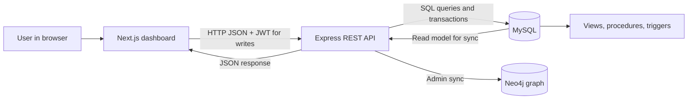

# Technical Walkthrough: Supply Chain Risk and Demand System

This document explains the running application for a project reviewer: its components, relational and graph data models, request paths, calculations, and database rules. The academic MySQL schema is external to this starter; the details below describe the schema and data that were inspected in the configured project database on 2026-11-02.

## 1. Project at a Glance


The application monitors products and stock across warehouses, reports demand and inventory risk, and models supplier/product/warehouse relationships in Neo4j.

- **Web client:** Next.js 15, React 19, TypeScript, Recharts, and Lucide icons.
- **API:** Node.js 24 runtime in the verified environment, Express 4, `mysql2/promise`, JWT, and bcrypt.
- **Relational store:** MySQL 8. MySQL is the source of truth for products, inventory, orders, risks, demand, suppliers, customers, and warehouses.
- **Graph store:** Neo4j is optional. It is refreshed from MySQL by an administrator; it is not the primary source of operational data.

The web client does not connect directly to either database. It calls the Express API, which validates requests and performs database work.

## 2. Component and Data Flow



Typical read flow:

1. A page or component requests an API endpoint with `fetch`.
2. Express runs a parameterized SQL query or stored routine using a pooled MySQL connection.
3. MySQL returns rows, sometimes through a view or trigger-maintained table.
4. Express returns JSON; the React page renders tables, KPI values, and charts.

Typical write flow:

1. The user submits a form. The browser sends JSON and an `Authorization: Bearer <JWT>` header.
2. Authentication middleware validates the JWT; role middleware checks the action's required role.
3. Express validates inputs and executes a transaction where multiple tables must remain consistent.
4. MySQL constraints and triggers provide a second integrity check.
5. The API commits and returns the created ID or a validation/conflict error. The page refreshes its affected data.

## 3. MySQL Data Model

The inspected database has **18 project tables** and **3 application-owned tables**, plus 2 views. The 18 project tables are:

`adjustment_reason`, `category`, `customer`, `demand_forecast`, `demand_history`, `inventory`, `inventory_risk`, `po_item`, `product`, `purchase_order`, `sales_order`, `so_item`, `stock_movement`, `stock_transfer`, `supplier`, `supplier_product`, `uom`, and `warehouse`.

Key relationships:

- `product` references `category` and `uom`.
- `supplier_product` is the many-to-many link between suppliers and products; it stores unit cost, lead time, and preferred-supplier status.
- `inventory` links each product to a warehouse and stores on-hand, reserved, reorder, minimum, and maximum quantities. A unique index prevents more than one inventory record for the same product/warehouse pair.
- `sales_order` links a customer and warehouse; `so_item` contains its product lines.
- `purchase_order` and `po_item` represent supplier purchasing.
- `inventory_risk`, `stock_movement`, `stock_transfer`, `demand_history`, and `demand_forecast` record operational or analytical events.

The three application-owned tables are separate from academic project tables:

- `app_users`: username, bcrypt password hash, role (`admin` or `staff`), and active status.
- `app_managed_orders`: marks only orders created through this app and records the creating user. This prevents the app from exposing destructive controls for historical seed orders.
- `app_order_reservations`: records the inventory row and quantity reserved by each app-created order and whether the reservation was released.

The views are `vw_inventory_status` and `vw_sales_order_summary`. The database also has `GetLowStock` and `GetSupplierProducts` stored procedures, and the triggers `auto_stockout_risk` and `check_stock_before_order`.

## 4. Authentication and Roles

`POST /api/auth/login` looks up an active username in `app_users`, compares the submitted password with the bcrypt hash, and returns a signed JWT. Tokens expire after 8 hours and carry the user ID, username, and role.

- `authenticate` rejects a missing, invalid, or expired token with HTTP 401.
- `authorize('admin', 'staff')` allows either role for routine writes such as product/inventory changes and pending order create/cancel.
- Admin-only actions include product deletion, deletion of app-created cancelled orders, and Neo4j synchronization.

The project has an admin bootstrap command but no public staff-registration or user-management screen. Staff accounts must be provisioned by the team.

## 5. Inventory: Add and Adjust Stock

### Add a Stock Record

1. The Inventory page calls `GET /api/manage/inventory-lookups`. The response contains active products, warehouses, and existing product/warehouse pairs.
2. The form hides pairs that already exist and collects initial on-hand, reserved, reorder, minimum, maximum, and location values.
3. `POST /api/manage/inventory` requires an admin/staff JWT. The API validates positive IDs, integer/nonnegative quantities, `reserved <= on_hand`, and `max >= min`.
4. Inside a transaction, it locks and verifies the active product and warehouse, inserts the row, and commits.
5. MySQL's unique product/warehouse index prevents duplicates even if another user inserts the pair after the form loaded. The API returns HTTP 409 for that race/duplicate.

### Adjust an Existing Stock Record

`PATCH /api/manage/inventory/:id` validates all quantity fields, locks through a transaction, updates the inventory row, and commits. The `auto_stockout_risk` trigger runs after the update.

Available stock is calculated as:

```text
available_quantity = quantity_on_hand - reserved_quantity
```

The `vw_inventory_status` view assigns status in this order:

1. `Critical` if available quantity is less than or equal to `min_stock_level`.
2. `Low` if available quantity is less than or equal to `reorder_level`.
3. `Overstock` if on-hand quantity is greater than `max_stock_level`.
4. `Healthy` otherwise.

The `auto_stockout_risk` trigger opens a `Stockout` risk when available stock is at/below minimum and there is no existing open Stockout risk for that inventory row. It assigns score 100 / Critical when available stock is zero or lower; otherwise score 85 / High. This trigger is idempotent while an open Stockout risk exists.

## 6. Sales Orders and Stock Reservation

### Creating an Order

1. The New Order form calls `GET /api/manage/order-lookups` for customers, warehouses, active products, and stock by product/warehouse.
2. The user selects a warehouse first. The form displays each product's available stock for that warehouse and sets the quantity input's maximum to that value. Product lines must be unique within an order.
3. The form sends customer, warehouse, optional required date, and line items to `POST /api/manage/orders` with a JWT.
4. Express validates the date (today or later), IDs, item count, positive whole-number quantities, and duplicate product lines.
5. The API begins a transaction, locks the inventory rows with `SELECT ... FOR UPDATE`, and rechecks available stock. This server-side check handles stock changing after the form loaded.
6. It creates a `Pending` sales order and an `app_managed_orders` marker. For each item it calculates `line_total = quantity * product.unit_price`, with discount and tax currently set to zero, inserts `so_item`, increases `inventory.reserved_quantity`, and inserts an `app_order_reservations` ledger row.
7. It commits all changes together. Any validation, SQL, or trigger failure rolls the transaction back.

The order total is calculated in Express as the sum of line totals, rounded to two decimal places. MySQL also enforces a nonnegative order total and the valid order status set.

The `check_stock_before_order` trigger runs before each `so_item` insert. It finds the order's warehouse, sums on-hand minus reserved stock for that product/warehouse, and raises a SQL error if the requested quantity exceeds that amount. This independently protects inserts even if they do not come from the web API.

### Cancelling or Deleting

- `POST /api/manage/orders/:id/cancel` allows admin/staff to cancel only a `Pending` order that has active application-managed reservations. It locks the order/reservations/inventory rows, decrements reserved quantities, marks the ledger rows released, changes status to `Cancelled`, and commits.
- `DELETE /api/manage/orders/:id` is admin-only and accepts only cancelled orders with an app-managed marker. It deletes order lines and the order in a transaction. Foreign-key cascades remove app tracking rows.
- Historical seed orders have no app-managed marker, so they are read-only and show no destructive actions. Deleting an order is optional; cancellation is the normal operation when an app-created pending order should not proceed.
- Editing order lines and Confirmed/Shipped/Delivered transitions are not implemented. Those require fulfillment/business rules.

## 7. Dashboard and Analytics Calculations

### Dashboard

`GET /api/dashboard/stats` returns scalar counts for products, warehouses, suppliers, customers, inventory rows, sales orders, open risks, and Low/Critical inventory rows. The Low/Critical count is computed from `vw_inventory_status`. It also returns the seven most recent orders and up to eight stock-attention rows from the views.

`vw_sales_order_summary` joins orders, customers, warehouses, and order items. It reports `total_items` as the count of `so_item` rows and reads `total_amount` from `sales_order`; it does not calculate the total itself.

### Demand

`GET /api/analytics/demand` returns:

- Up to 100 newest `demand_history` rows.
- Up to 100 `demand_forecast` rows ordered by forecast date.
- Up to 15 products ranked by total historical demand.

For the summary, MySQL computes `historical_demand` as the sum of `quantity_demanded` for the product and `forecast_demand` as the sum of its `forecasted_quantity` values. These are stored historical/forecast records; the app does **not** train or run a forecasting model.

### Risk

`GET /api/analytics/risk-summary` counts all risk rows, open rows, open Critical rows, and open High rows, and returns up to 100 recent inventory-linked risk records joined to product and warehouse names.

### Stored Procedures

- `GetLowStock(wid)` returns inventory in the requested warehouse whose available quantity is at or below its reorder level.
- `GetSupplierProducts(sid)` returns the selected supplier's products, unit costs, lead times, and preferred flags.

## 8. Neo4j Graph and Synchronization

MySQL remains the source of truth. The admin-only `POST /api/neo4j/sync` reads suppliers, warehouses, products, `supplier_product`, and inventory from MySQL, then runs a Neo4j write transaction.

- Uniqueness constraints use each MySQL ID as the graph node key.
- `MERGE` creates missing nodes/relationships or reuses existing ones, making repeated syncs idempotent.
- Nodes: `Supplier`, `Warehouse`, and `Product`.
- Relationships: `(Supplier)-[:SUPPLIES]->(Product)` from `supplier_product`, and `(Product)-[:STORED_AT]->(Warehouse)` from inventory.
- The relationship stores the current stock quantity/reservation/available quantity; `available = onHand - reserved`.

`GET /api/neo4j/summary` counts nodes and relationships. `GET /api/neo4j/supplier-network` returns supplier/product edges for the graph view. Neo4j is optional; MySQL-backed pages continue to work if it is unavailable.

## 9. Testing and Running the Full Suite

With MySQL and the backend API running, use this in PowerShell from `backend`:

```powershell
$env:ALLOW_DB_INTEGRATION_TESTS='true'
$env:API_BASE_URL='http://localhost:5000'
$env:VERIFY_NEO4J='true'
npm run test:all
Remove-Item Env:ALLOW_DB_INTEGRATION_TESTS,Env:API_BASE_URL,Env:VERIFY_NEO4J
```

Set `API_BASE_URL` to the actual API URL. Omit `VERIFY_NEO4J` if Neo4j is unavailable. The integration suite creates uniquely named temporary accounts, product/inventory records, orders, and risks, validates responses and trigger effects, then removes the fixtures. Run it only against a development/test database, never a production database. The test scripts are `backend/test/auth.test.js`, `backend/test/integration-crud.js`, and `backend/test/run-all.js`.

Frontend checks:

```powershell
cd ..\frontend
npm run lint
npm run build
```

## 10. Scope and Limitations

- The academic MySQL schema and seed data must be provided separately; this starter assumes they already exist.
- There is no staff-registration/user-management UI. The admin bootstrap command creates an administrator; staff accounts must be provisioned by the team.
- Supplier, warehouse, customer, transfer, and purchase-order pages are primarily read-only. Product and inventory are writable; the sales-order workflow is pending-only and cannot edit lines or model later fulfillment transitions.
- Do not rerun destructive seed SQL. Do not commit credentials.

For the ER diagram and screenshots, see [the final report](FINAL_REPORT.md).
